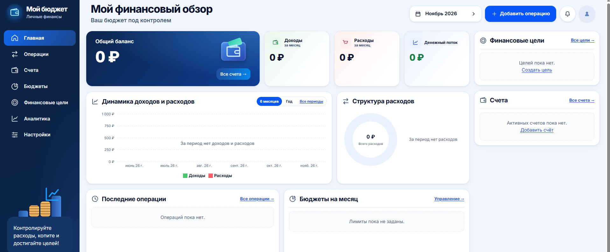
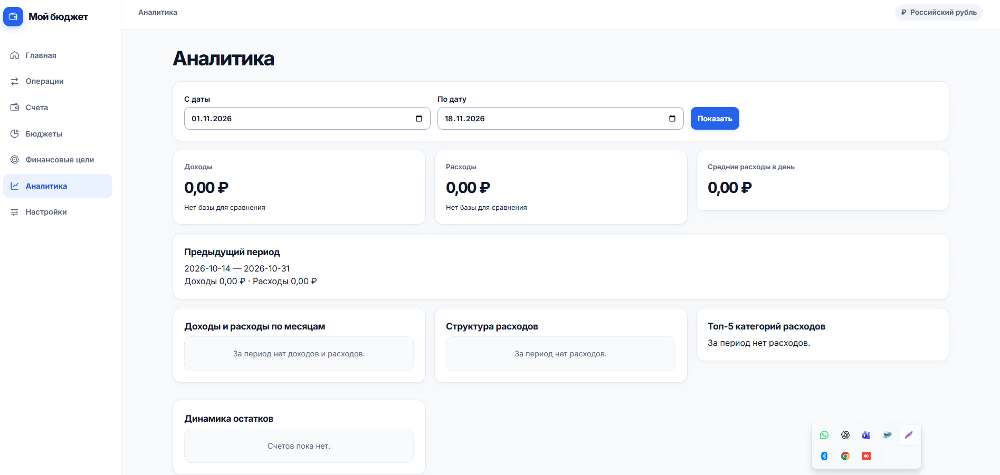
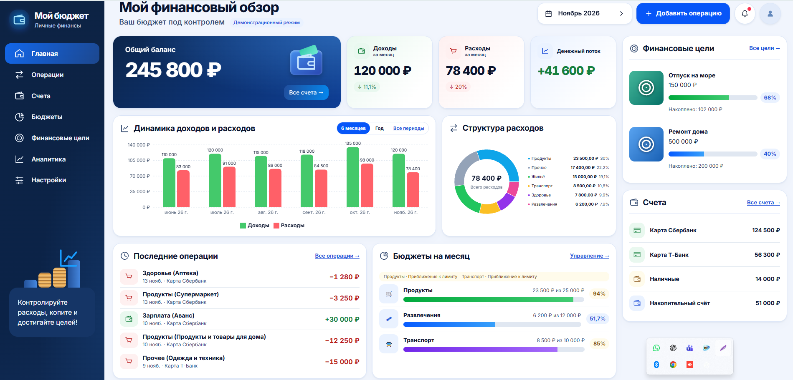

<h1 align="center">💰 Мой бюджет</h1>

<p align="center"><strong>Личные финансы в одном месте — от ежедневных расходов до больших целей.</strong></p>

<p align="center">
  
  
  
  
</p>

---

## 🧠 О проекте

**«Мой бюджет»** — русскоязычное веб-приложение для учёта личных финансов. Оно помогает записывать доходы и расходы, отслеживать остатки на счетах, планировать траты по категориям и видеть, как продвигается накопление на цели.

Приложение запускается на компьютере и открывается в браузере. Финансовые данные хранятся в локальной базе SQLite. Текущая версия рассчитана на одного пользователя и расчёты в рублях.



---

## 🎯 Какую задачу решает

Когда деньги распределены между наличными, картами и накопительными счетами, сложно быстро оценить общую картину. Записи расходов помогают понять, куда уходят деньги, а лимиты и цели связывают ежедневные решения с планами на месяц.

«Мой бюджет» собирает операции и счета в одном месте. На главной можно посмотреть общий баланс, доходы и расходы за месяц, структуру трат и состояние бюджетов. Переводы между своими счетами учитываются отдельно от доходов и расходов.



Например, пользователь задаёт месячный лимит на продукты, записывает покупки и следит за оставшимся бюджетом. Одновременно он может вести цель «Отпуск» и отмечать взносы, чтобы видеть прогресс накоплений.



---

## 👤 Для кого

| Пользователь | Какую пользу получает |
| --- | --- |
| **Человек, который начинает вести бюджет** | Записывает операции по категориям и постепенно узнаёт структуру своих расходов. |
| **Пользователь с несколькими счетами** | Видит остатки и учитывает переводы между наличными, картой и накопительным счётом. |
| **Тот, кто планирует расходы** | Устанавливает месячные лимиты и отслеживает приближение к ним. |
| **Тот, кто копит на покупку или событие** | Создаёт финансовую цель, фиксирует взносы и наблюдает за прогрессом. |

---

## 🛠️ Возможности

### 📊 Главная и аналитика

Общий баланс, доходы, расходы и денежный поток за выбранный месяц. Графики показывают динамику доходов и расходов и распределение трат по категориям. На главной также доступны последние операции и состояние месячных лимитов.

### 💸 Операции, счета и категории

Добавление, редактирование и удаление доходов, расходов и переводов. Фильтры помогают найти нужные записи, а справочники счетов и категорий позволяют организовать учёт под свои привычки.

### 🗓️ Бюджеты и финансовые цели

Месячные лимиты по категориям с индикаторами использования и предупреждениями. Для финансовой цели можно задать сумму и учитывать взносы.

### 📁 Отчёты и перенос данных

Импорт и экспорт операций в CSV, отчёты Excel и полные резервные копии JSON. Перед импортом доступен предварительный просмотр, а при восстановлении проверяется файл резервной копии.

---

## ⚙️ Технологии

| Часть приложения | Технологии |
| --- | --- |
| Интерфейс | React, TypeScript, Vite, Tailwind CSS |
| Графики | Recharts |
| Сервер и API | Node.js, Express, Zod |
| Хранение данных | SQLite, Prisma, миграции |
| Проверки | Vitest, Playwright, ESLint |
| Локальное развёртывание | Docker Compose |

Денежные суммы хранятся целыми копейками. Сервер проверяет входные данные и рассчитывает остатки и сводные показатели. В настройках доступен выбор светлой или тёмной темы.

---
Локальный русскоязычный трекер доходов, расходов, переводов, бюджетов и финансовых целей. Требуется Node.js 22.12 или новее.

## Запуск

В Windows дважды щёлкните «Запустить Мой бюджет.cmd». Скрипт открывает локальный адрес в браузере и пересобирает приложение при изменениях исходников.

Для запуска вручную выполните в каталоге проекта:

```sh
npm ci
npm run db:migrate
npm run db:seed
npm run dev
```

Интерфейс доступен на http://127.0.0.1:5173. Сервер отвечает на http://127.0.0.1:3000/health. Миграции можно повторять при обновлении. Seed добавляет стандартные категории по типу и названию. Выполните его при первой настройке.

```sh
npm run build
npm start
```

Сборка объединяет клиент и API на http://127.0.0.1:3000. База по умолчанию находится в `prisma/budget.db`. Для другой базы задайте `DATABASE_URL` в окружении перед миграцией и запуском.

## Docker Compose

```sh
docker compose up --build
```

Приложение доступно на http://127.0.0.1:3000. Контейнер применяет миграции при старте и создаёт категории при инициализации тома `budget-data`.

## Резервирование и перенос

В настройках скачайте «Резервная копия JSON». Для восстановления выберите файл, проверьте количество записей и подтвердите замену. Восстановление заменяет все текущие данные одной транзакцией. Перед заменой скачайте копию текущей базы.

CSV предназначен для переноса операций. Используйте заголовки экспорта и сохраните UTF-8. Счета и категории должны существовать в целевой базе. Импорт добавляет операции и возвращает ошибки по строкам. Перед подтверждением интерфейс показывает операции и ошибки по строкам. Возможные дубликаты пропускаются по умолчанию. Они определяются по типу, дате, сумме, счетам, категории и комментарию. XLSX содержит шесть листов для отчётности.

## Проверки

```sh
npm run typecheck
npm run lint
npm test
npm run build
npx playwright install chromium
npm run test:e2e
```

E2E запускается на отдельной базе и порту 3100. Команды проверяют расчёты, сценарии API и интерфейс.

MVP рассчитан на одного пользователя и рубли. Защита публичного доступа потребует авторизации. Одна операция или лимит ограничены 21 474 836,47 ₽. Для аналитики доступны периоды до 3660 дней. Импорт принимает до 10 000 строк операций в одном файле. Первый день недели хранится в настройках. Выбор дат использует календарь браузера.

[Техническое задание](TECHNICAL_SPEC.md) · [Этапы разработки](AGENTS.md)
